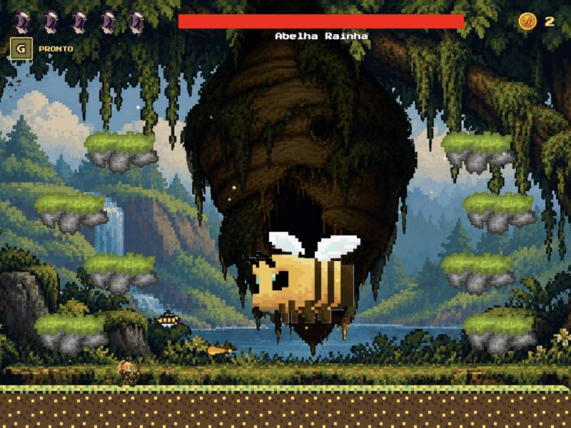

# Sky Serpents Supremo

Jogo de plataforma 2D em pixel art, feito com [Phaser 3](https://phaser.io) (JavaScript puro, sem build).
Escolha o **Guerreiro** (espada) ou a **Arqueira** (arco), atravesse cada fase e derrote o chefão no final.

No menu principal:
- **1 jogador**: escolha o personagem e a fase.
- **2 jogadores**: Guerreiro e Arqueira na mesma tela, cada um com as suas teclas. Um não avança sem o outro: ninguém sai da tela. Cuidado com o parceiro: espada, flechas e especiais acertam ele também (o escudinho segura). Quem fica sem corações volta 6 s depois ao lado do parceiro, e o game over só vem com os dois fora.
- **Opções**: troque as teclas do jogador 1 e do jogador 2.



## Como rodar

O jogo precisa de um servidor local (abrindo o `index.html` direto, o navegador bloqueia o carregamento das imagens e dos arquivos `.json`).

Na pasta do jogo:

```bash
python -m http.server 8000
```

(no Windows também funciona `py -m http.server 8000`; ou use a extensão **Live Server** do VS Code)

Depois abra <http://localhost:8000> no navegador.

## Controles

| Ação | Teclado | Celular / mouse |
| --- | --- | --- |
| Andar | ← → ou A D | analógico (encoste na parte esquerda da tela) |
| Pular | ↑ ou W | analógico para cima |
| Agachar (escudinho: segura 1 golpe, recarrega em 8 s) | ↓ ou S | analógico para baixo |
| Atacar | Espaço ou K | botão **ESPAÇO** |
| Especial | G ou L | botão **G** |
| Pausar | P | botão **II** |
| Reiniciar a fase | R (pede confirmação) | pela pausa |
| Voltar ao menu | ESC (pede confirmação) | pela pausa |

Essas são as teclas padrão: jogando sozinho valem as do jogador 1 (WASD, Espaço, G) e as do
jogador 2 (setas, K, L); com 2 jogadores cada um usa só as suas. Dá para trocar em **Opções**, no menu
principal (a escolha fica guardada no navegador; os padrões estão em `src/config/controls.js`).

O jogo também pausa sozinho quando a janela perde o foco (trocar de aba, minimizar).

## Fases

| Fase | Nome | Chefão |
| --- | --- | --- |
| 1 | Campos de Fogo | Dragão Vermelho |
| 2 | Pico Congelado | Serpente Glacial |
| 3 | Santuário Místico | Dragão Rosa Místico |
| 4 | Selva Gelada | Urso Polar |
| 5 | Floresta do Mel | Colmeia → Abelha Rainha |

**Moedas:** cada bicho derrotado tem 30% de chance de deixar uma moeda. O total fica guardado no navegador e aparece no canto superior direito (no jogo e no menu).

**Estrelas:** o relógio no topo da tela conta o tempo da fase (a pausa não conta). Terminando rápido você ganha até 3 estrelas — os tempos de cada fase ficam em `STAR_TIMES`, no arquivo dela. Na escolha de fase, as fases concluídas ganham um check verde e mostram as estrelas e o recorde.

## Estrutura do projeto

```
index.html          carrega o Phaser e os scripts (a ordem importa)
src/
  config/           configurações: personagens, bichos, chefões, terrenos, dificuldade
  levels/           as FASES, uma por arquivo (level_01.js ... level_05.js) + a lista da campanha
  core/             base do jogo: entidades, combate, eventos, controles
  player/           jogador (knight/ = guerreiro, archer/ = arqueira)
  enemies/          bichos pequenos
  bosses/           chefões, cada um na sua pasta (dragon/, serpent/, bear/, hive/, bee/)
  items/            poções e moedas
  projectiles/      projéteis dos chefões
  ui/               interface (HUD, menus, telas, controles de toque)
  world/            cenário (mapa, fundo, clima, música)
  scenes/           carregamento, menu principal, opções, personagem, escolha de fase, fase e pausa
assets/             tudo o que o jogo carrega (imagens, sons, folhas de animação)
source_art/         artes ORIGINAIS usadas pelas ferramentas (o jogo não carrega daqui)
tools/              scripts Python que geram as imagens de assets/ a partir de source_art/
docs/screenshots/   capturas de tela
```

As fases são **dados**: o código das regras (física, combate, chefões) é o mesmo para todas, e cada fase só descreve o terreno, os bichos e o chefão. É o mesmo jeito que os jogos profissionais separam conteúdo de código.

### Criar uma fase nova

1. Copie um arquivo de `src/levels/` (ex.: `level_05.js` → `level_06.js`) e troque o nome da constante (`LEVEL_06`), o `NUMBER` e o conteúdo.
2. Adicione `LEVEL_06` na lista de `src/levels/levels.js`.
3. Adicione `<script src="src/levels/level_06.js"></script>` no `index.html`, antes de `levels.js`.

O formato de cada campo está explicado em `src/levels/level_helpers.js`.

### Ajustar os chefões

A vida de cada chefão é o `MAX_HP` em `src/config/boss_types.js` (é a vida real, sem multiplicador).
Referência: cada golpe de espada tira 15 e cada flecha tira 12.

## Ferramentas (`tools/`)

Precisam de Python 3 e da biblioteca Pillow (`pip install pillow`). Exemplos:

```bash
python tools/boss_intros.py
```

| Script | O que gera |
| --- | --- |
| `walk_frames.py` | quadros de caminhada dos personagens (mexe só pernas e mão) |
| `favicon.py` | ícones da aba do navegador e do atalho no celular |
| `boss_intros.py` | imagens de abertura dos dragões e da serpente |
| `bee_boss_sprites.py` | colmeia (cenário + recorte), animação da Abelha Rainha, mel |
| `coin_sprite.py` | a moeda |
| `honey_background.py` / `honey_terrain.py` | fundo infinito, terreno e árvores amarelas da Floresta do Mel |
| `jungle_background.py` | fundo da Selva Gelada |
| `dragon_sheet.py`, `bear_sheet.py`, `bear_retouch.py` | folhas de animação dos chefões |
| `creature_sprites.py`, `dragon_variants.py`, `terrain_variants.py`, `archer_from_image.py` | bichos, cores e personagens |

## Licença

Todos os direitos reservados. Veja [LICENSE](LICENSE).
